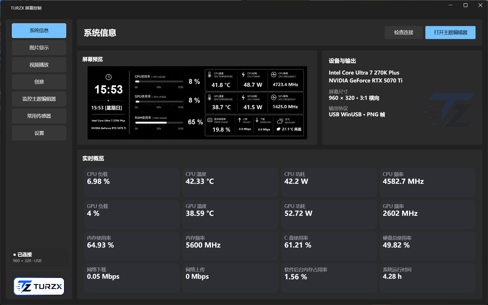
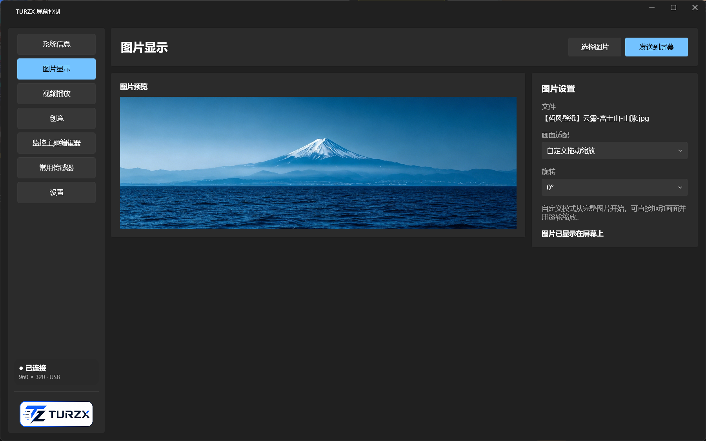
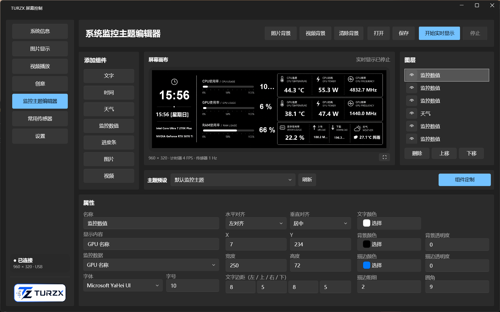
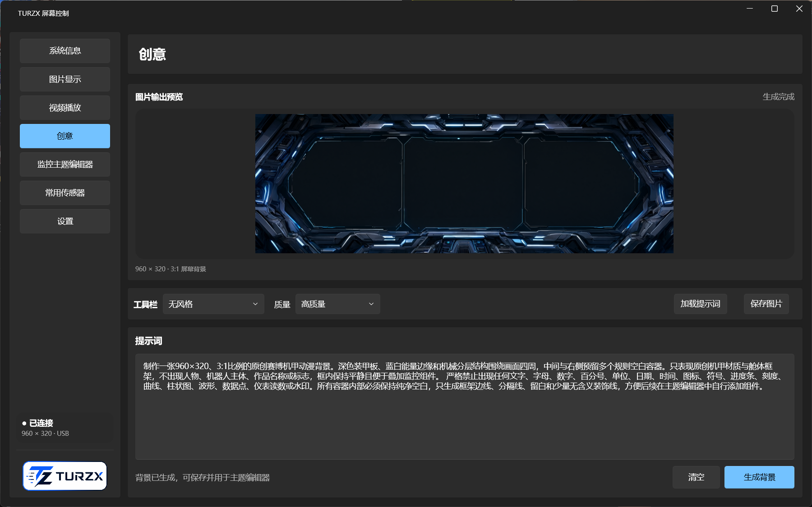
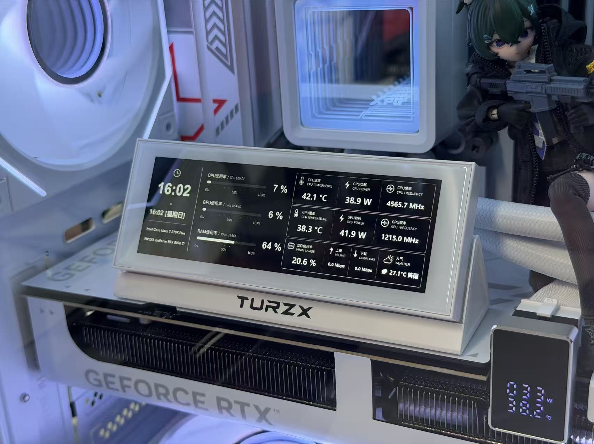

# TURZX Pro 4.6

  

一款面向 **TURZX 4.6 英寸 USB 副屏**的现代化 Windows 控制软件。支持图片、视频、实时硬件监控、可视化主题编辑和 AI 背景创作，并提供深浅色界面、开机启动与系统托盘。

> 本项目是独立开发的软件，并非 TURZX 原厂软件。当前版本针对 USB `VID 1CBE / PID 0046`、逻辑分辨率 `960 × 320` 的横置屏幕开发。



## 主要功能

- **实时系统监控**：CPU、GPU、内存、显存、磁盘、网络、温度、功耗、频率、风扇和系统运行时间。
- **监控主题编辑器**：自由添加文字、时间、天气、监控数值、进度条、图片和视频组件；支持图层、拖动、缩放、字体、颜色、透明度、圆角及边框设置。
- **图片显示**：支持常见图片格式、完整显示、裁剪铺满、拉伸、自定义拖动缩放和手动旋转。
- **视频播放**：支持 MP4 等 FFmpeg 可解码格式、自定义裁剪、旋转、循环与多档帧率。
- **AI 创意背景**：兼容 OpenAI Images 风格接口与阿里云百炼 Qwen Image 原生接口，内置多类 960 × 320 提示词模板。
- **主题预设**：主题会同时保存组件、背景和媒体素材，可直接载入复用。
- **后台运行**：关闭窗口后最小化到系统托盘；支持开机启动。
- **本地安全**：不内置任何 API Key，不收集遥测；API Key 使用 Windows DPAPI 按当前用户加密保存在本机。

## 界面预览

<table>
  <tr>
    <td width="50%"></td>
    <td width="50%"></td>
  </tr>
  <tr>
    <td align="center">图片显示与自定义裁剪</td>
    <td align="center">可视化监控主题编辑器</td>
  </tr>
  <tr>
    <td colspan="2"></td>
  </tr>
  <tr><td colspan="2" align="center">AI 生成 3:1 屏幕背景框架</td></tr>
</table>

## 实机效果



## 下载与安装

1. 打开仓库右侧的 **Releases**，下载 `TURZX-Pro-v1.0-Setup.exe`。
2. 退出 TURZX 原厂控制软件，避免两个程序同时占用 USB 设备。
3. 运行安装程序，然后启动 **TURZX Pro 4.6**。
4. 将屏幕通过 USB 连接到电脑，软件会自动检查设备。
5. 如需 CPU 温度、功耗和主板风扇等数据，在“设置 → 硬件传感器权限”中安装 PawnIO 驱动与 TURZX 本地服务。安装时会出现 Windows UAC 提示。

也可以下载 Release 中的便携版 ZIP，解压后运行 `Turzx.ControlPanel.Wpf.exe`。

Release 还提供 `TURZX-Pro-v1.0-Theme-black1.zip` 黑白硬件监控主题。将其中的 `Theme` 文件夹解压到软件目录并合并，重启软件后即可在“监控主题编辑器 → 主题预设”中选择 `black1`。

> v1.0 暂未使用商业代码签名证书，Windows SmartScreen 可能显示“未知发布者”。请只从本仓库 Release 下载，并使用随 Release 提供的 `SHA256SUMS.txt` 校验文件完整性。

### 运行环境

- Windows 10 / Windows 11 x64
- .NET Framework 4.7.2 或更高版本
- TURZX 4.6 英寸屏幕（当前测试设备：`VID 1CBE / PID 0046`）
- 视频输出需要 FFmpeg：将 `ffmpeg.exe` 放在软件目录或 `ffmpeg` 子目录中，亦可安装到系统 `PATH`

## 第一次使用

- **图片/视频**：进入对应页面选择文件，调整适配和旋转后发送到屏幕。
- **实时主题**：进入“监控主题编辑器”，选择背景、添加组件并点击“开始实时显示”。
- **black1 主题**：安装 Release 中的主题包后，在主题预设中选择 `black1`；不同电脑可在传感器设置中重新映射硬件数据。
- **天气**：在设置中填写城市并保存。
- **AI 背景**：在设置中填写自己的 API 地址、API Key 和模型。项目及安装包不包含开发者密钥。
- **退出软件**：关闭窗口只会进入托盘；在托盘图标上点击右键并选择“退出软件”才能彻底退出。

## 隐私与安全

- 软件不会上传硬件传感器数据，也不包含统计或遥测模块。
- 天气功能只向 Open-Meteo 发送用户填写的城市坐标。
- AI 功能只在用户主动生成图片时请求用户配置的服务商。
- API 配置保存在 `%APPDATA%\TurzxControl`，其中 API Key 使用 Windows 当前用户凭据加密。
- 发布包不包含开发环境配置、日志、主题缓存、用户图片、API 地址或 API Key。

更多说明请查看 [PRIVACY.md](PRIVACY.md) 与 [SECURITY.md](SECURITY.md)。

## 从源码构建

在 Windows PowerShell 5.1 中运行：

```powershell
.\build.ps1
```

脚本会恢复 NuGet 依赖、解压 LibreHardwareMonitor 0.9.6，并使用 .NET Framework MSBuild 生成 x64 Release 文件。构建结果位于 `artifacts\wpf`。

## 第三方组件

- [WPF UI](https://github.com/lepoco/wpfui)
- [LibreHardwareMonitor](https://github.com/LibreHardwareMonitor/LibreHardwareMonitor)
- [PawnIO](https://pawnio.eu/)（可选硬件传感器驱动）
- [Open-Meteo](https://open-meteo.com/)（天气数据）
- [FFmpeg](https://ffmpeg.org/)（视频解码，需用户自行提供）

相关许可证和第三方声明随正式版一同放在 `licenses` 目录。

## 版本

当前正式版本：**v1.0**。更新内容见 [CHANGELOG.md](CHANGELOG.md)。
